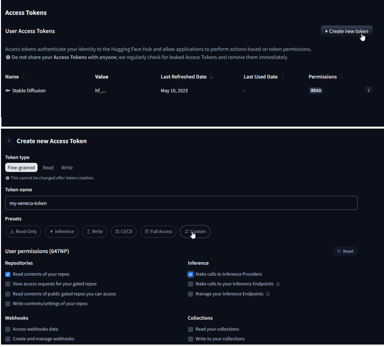

# AI Chatbot

A simple chatbot application that uses the Hugging Face API to generate AI responses. Perfect for learning full-stack web development!

## 🚀 How to Run the Project

### 1. Install Dependencies

First, install the required packages:

```bash
npm install
```

### 2. Set Up Environment Variables

Create a `.env` file in the root directory and add your Hugging Face API token:

```
HF_TOKEN=your_huggingface_token_here
```

To generate a token:

1. Sign in to [Hugging Face](https://huggingface.co/).
2. Open [Settings > Access Tokens](https://huggingface.co/settings/tokens).
3. Click **Create new token**, enter a name, and select the permissions needed for inference.
4. Create the token and copy it immediately. Hugging Face will not show the full token again.
5. Paste it into `.env` as the value of `HF_TOKEN`.



Keep your token private. Do not commit `.env`, expose the token in frontend code, or share it publicly.

### 3. Start the Backend Server

Run the backend server:

```bash
npm start
```

The server will start on `http://localhost:3000`

### 4. Open the Frontend

Navigate to the `public` folder and open `index.html` in your web browser.

That's it! You should now be able to chat with the AI.

---

## 📁 Project Structure

```
chatbot-project/
├── public/
│   ├── index.html      # Main HTML file
│   ├── style.css       # Styles for the chatbot
│   └── app.js          # Frontend JavaScript
├── server.js           # Backend Express server
├── package.json        # Project dependencies
├── .env               # Environment variables (create this)
└── README.md          # This file
```

---

## 🛠️ Technologies Used

### Frontend
- **HTML5** - Semantic markup
- **CSS3** - Modern styling with gradients and animations
- **JavaScript** - Fetch API for backend communication

### Backend
- **Node.js** - Runtime environment
- **Express.js** - Web server framework
- **Hugging Face API** - AI model integration

---

## 📚 How It Works

1. **User types a message** in the input field and clicks Send
2. **Frontend sends the message** to the backend via a POST request
3. **Backend forwards the request** to Hugging Face API
4. **AI generates a response** which is sent back to the frontend
5. **Response is displayed** in the chat interface

---

## 🎨 Features

- Clean and modern UI design
- Gradient backgrounds and smooth animations
- Responsive design for mobile devices
- Real-time chat interface
- Error handling for network issues

---

## 📝 Learning Objectives

This project teaches:
- Semantic HTML elements
- CSS styling and animations
- Asynchronous JavaScript with `fetch()`
- Express.js server setup
- API integration
- Environment variables
- Client-server communication

---

## 🔧 Troubleshooting

**Server won't start:**
- Make sure you ran `npm install`
- Check that your `.env` file exists and has a valid token

**Messages not sending:**
- Verify the backend is running on port 3000
- Check browser console for errors
- Ensure CORS is enabled (already configured)

**AI responses are weird:**
- The free model has limitations
- Try adjusting `max_tokens` in `server.js`

---

## 📄 License

This project is open source and available for educational purposes.